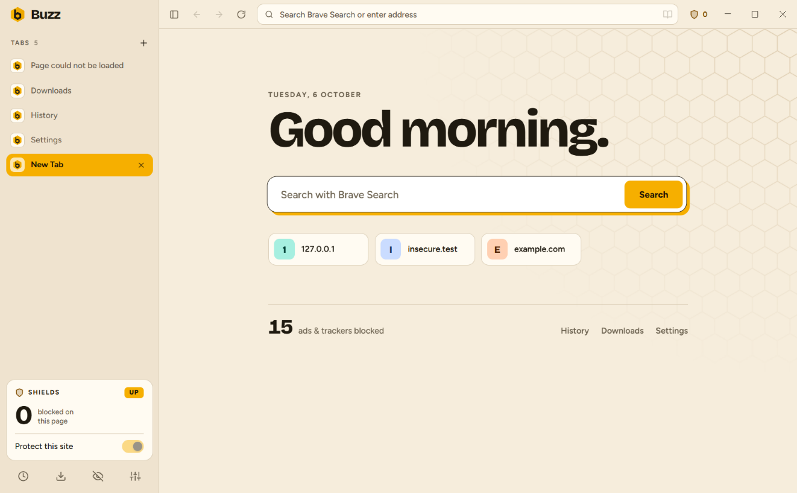
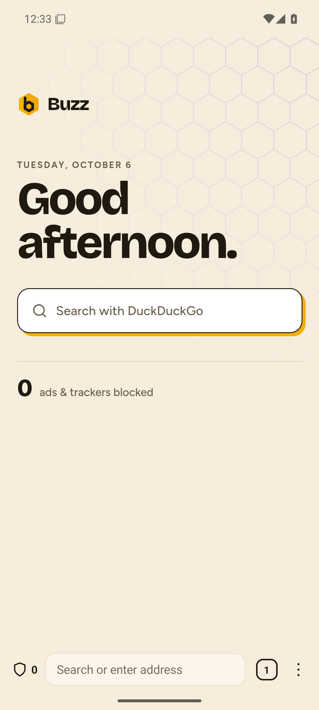
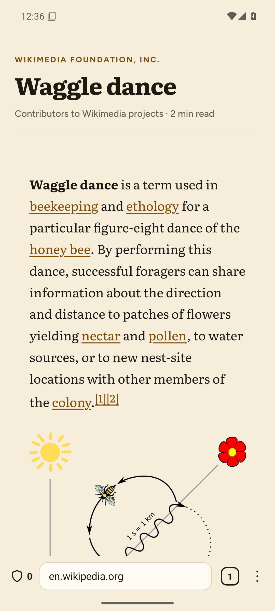
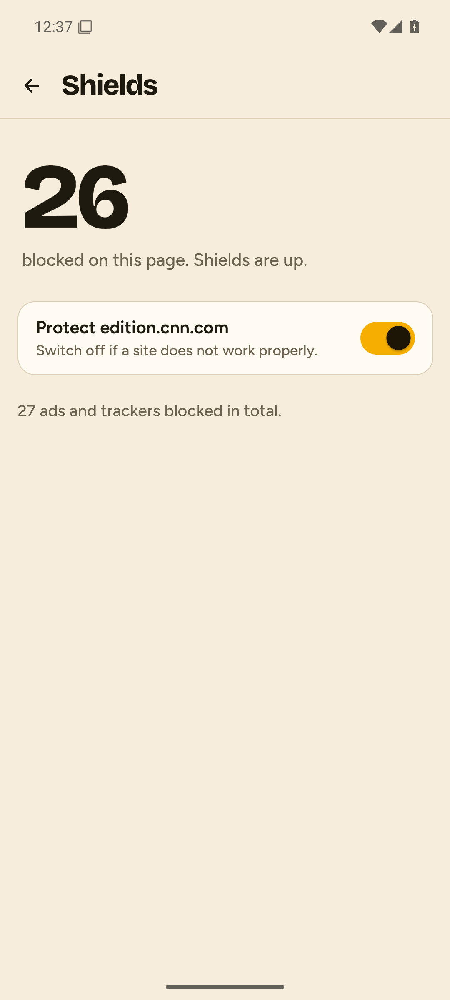
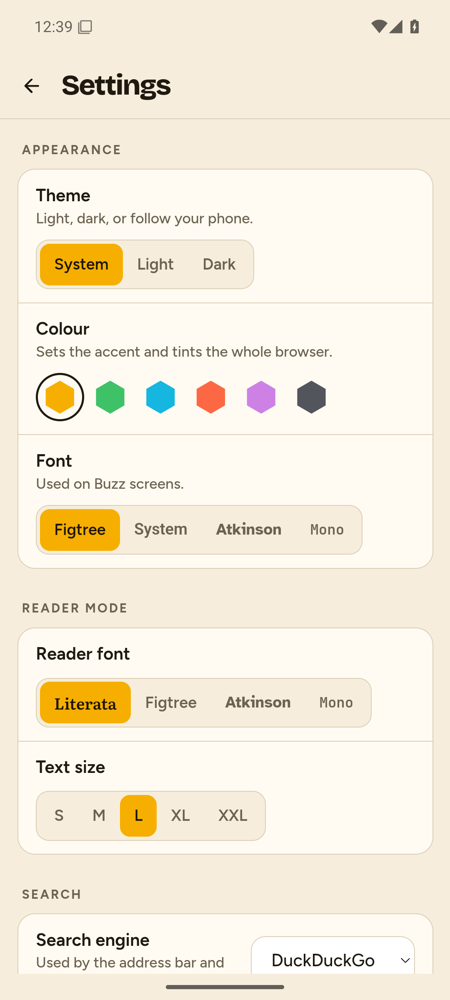
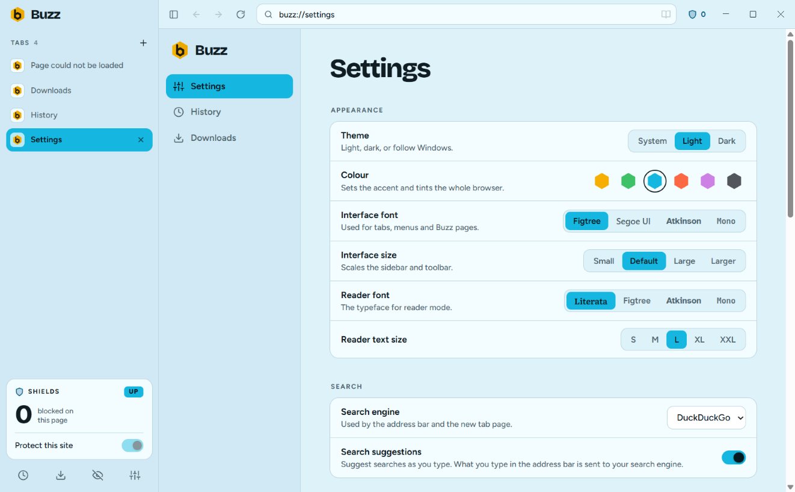
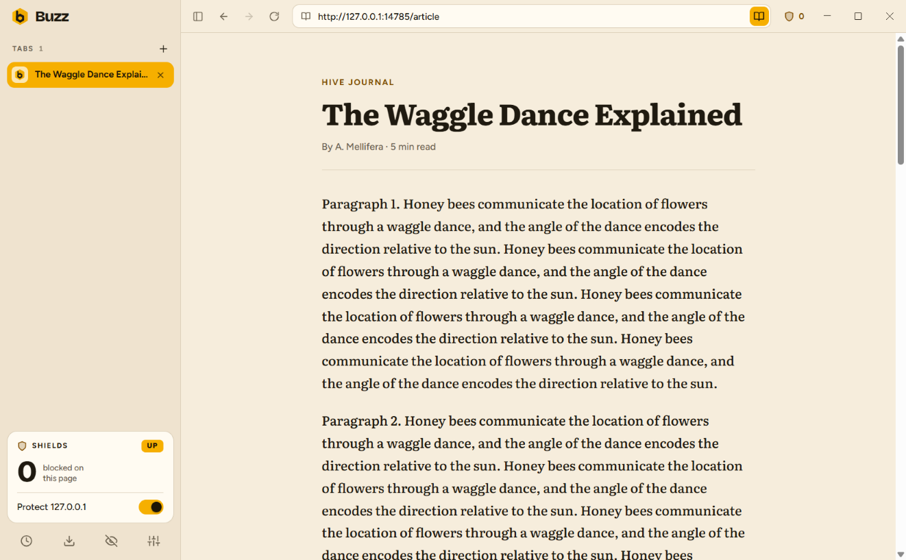

<p align="center">
  
</p>

<h1 align="center">Buzz</h1>

<p align="center">
  A privacy-first web browser for Windows and Android, built on Chromium.<br>
  Blocks ads and trackers, upgrades connections to HTTPS, and stays out of your way.
</p>

<p align="center">
  
  &nbsp;
  
</p>

## Download

Get the latest version from the [Releases page](../../releases/latest).

| Platform | File | Requirements |
|---|---|---|
| Windows | `Buzz-Setup-x.y.z.exe` | Windows 10 or 11, 64-bit |
| Android | `Buzz-x.y.z.apk` | Android 10 or newer, with an up-to-date Android System WebView (version 123+) |

### Installing on Windows

1. Download and run `Buzz-Setup-x.y.z.exe`.
2. Windows SmartScreen will warn that the app is from an unknown publisher, because the installer is not yet code-signed. Choose **More info**, then **Run anyway**.
3. Pick an install folder. No administrator rights are needed.

### Installing on Android

Buzz is not on the Play Store yet, so it is installed from the APK file.

1. Download `Buzz-x.y.z.apk` on your phone and open it.
2. Android will ask you to allow your browser or file manager to install apps. Allow it, then tap **Install**.
3. Optional: make Buzz your default browser under **Settings > Apps > Default apps > Browser app**.

Updates are manual for now on both platforms: download and install the newer version over the old one. Your settings and history are kept.

## Features

| | Windows | Android |
|---|:-:|:-:|
| Ad and tracker blocking, with a per-site off switch | ✓ | ✓ |
| Automatic HTTPS upgrade, with a warning before any insecure fallback | ✓ | ✓ |
| Private browsing with separate cookies and storage, wiped on close | windows | tabs |
| Reader mode | ✓ | ✓ |
| Choice of search engine: DuckDuckGo, Google, Bing, Brave Search, Startpage, Ecosia | ✓ | ✓ |
| Search suggestions and history matches in the address bar | ✓ | ✓ |
| History with search, per-entry removal and clear-by-time-range | ✓ | ✓ |
| Downloads list | ✓ | ✓ |
| Themes: light / dark / system, six colour schemes, a choice of fonts | ✓ | ✓ |
| Memory saver that puts background tabs to sleep | ✓ | ✓ |
| Tabs restored after a restart | | ✓ |
| Vertical tabs with a collapsible sidebar | ✓ | |
| Find in page, zoom, right-click menus | ✓ | |

<p align="center">
  
  
  
</p>
<p align="center">
  
  
</p>

## What Buzz is, and is not

Buzz uses the Chromium engine through an embedding layer rather than a patched copy of Chromium's source:

- **Windows:** [Electron](https://www.electronjs.org/), which bundles Chromium.
- **Android:** Android System WebView, the Chromium-based engine that ships with the phone and updates through the Play Store.

That keeps Buzz small and buildable on an ordinary laptop, and it comes with limits you should know about before relying on it:

- No browser extensions, and no sync between devices.
- No bookmarks or password manager yet.
- On Windows, DRM-protected video (Netflix, Prime Video and similar) does not play.
- On Android, sites cannot use the camera, microphone or location, and `blob:` downloads are not supported.
- Ad blocking on Android works by blocking requests to known ad and tracker hosts. It does not hide leftover empty ad slots the way the Windows version does.
- Windows memory use is close to other Chromium browsers at idle (about 450 MB with one tab). The memory saver is what makes the difference with many tabs open.
- Buzz has not had an independent security review. Treat it as an early release.

## Privacy

Buzz has no accounts, telemetry or analytics. The network requests it makes on its own behalf are:

- Downloading ad-blocking filter lists, about once a week.
- Search suggestions, sent to your chosen search engine as you type. This can be switched off in Settings.

History, settings and downloads stay on your device.

## Project layout

```
desktop/                  Windows app (Electron)
  src/main/               Windows, tabs, shields, history, downloads, internal pages
  src/ui/                 The browser's own interface: sidebar, toolbar
  src/pages/              buzz:// pages: settings, history, downloads
  src/assets/             Theme, fonts, icons, logo (also used by the Android app)
  test/smoke.js           End-to-end self-test that drives the real app
mobile/                   Android app (Kotlin)
  app/src/main/java/      Browser shell: tabs, ad blocking, HTTPS upgrade, reader, downloads
  app/src/main/assets/ui/ In-app screens: new tab, search, tabs, history, settings
  app/src/test/           Unit tests
.github/workflows/        Release build for both platforms
```

## Building from source

### Windows app

Requires [Node.js](https://nodejs.org/) 22 or newer.

```sh
cd desktop
npm install
npm start          # run Buzz
npm run smoke      # run the end-to-end self-test (opens windows briefly)
npm run dist       # build the installer into releases/desktop/
```

If `npm start` fails with `Cannot read properties of undefined (reading 'setPath')`, your terminal has `ELECTRON_RUN_AS_NODE` set (some editors do this). Clear it and try again.

### Android app

Requires JDK 17 and the Android SDK (platform 35, build-tools 35). Point Gradle at the SDK with an `ANDROID_HOME` environment variable or a `mobile/local.properties` file containing `sdk.dir=...`.

```sh
cd mobile
./gradlew testDebugUnitTest   # run the unit tests
./gradlew assembleDebug       # build a debug APK into app/build/outputs/apk/debug/
./gradlew assembleRelease     # build the release APK (needs a signing key, see below)
```

The Android build copies the theme, fonts and icons from `desktop/src/assets`, so keep both folders checked out together.

## Publishing a release

Releases are built by GitHub Actions when a version tag is pushed.

**One-time setup: the Android signing key.** Android only installs an update if it is signed with the same key as the version already on the phone. Create a key once, keep it safe, and never commit it:

```sh
cd mobile
keytool -genkeypair -keystore buzz-release.jks -storetype PKCS12 -keyalg RSA -keysize 2048 \
  -validity 10000 -alias buzz
```

For local release builds, put its details in `mobile/keystore.properties`:

```properties
storeFile=buzz-release.jks
storePassword=...
keyAlias=buzz
keyPassword=...
```

For GitHub builds, add four repository secrets under **Settings > Secrets and variables > Actions**:

| Secret | Value |
|---|---|
| `ANDROID_KEYSTORE_BASE64` | The key file, base64-encoded (`base64 -w0 buzz-release.jks`) |
| `ANDROID_KEYSTORE_PASSWORD` | The keystore password |
| `ANDROID_KEY_ALIAS` | `buzz` |
| `ANDROID_KEY_PASSWORD` | The key password |

If the key is lost, existing Android users cannot update and must uninstall and reinstall. Back it up somewhere outside this repository.

**Each release:**

1. Set the new version in `desktop/package.json` (`version`) and in `mobile/app/build.gradle.kts` (`versionName`, and increase `versionCode` by one).
2. Commit, then tag and push:
   ```sh
   git tag v0.2.0
   git push origin main --tags
   ```
3. The workflow builds `Buzz-Setup-0.2.0.exe` and `Buzz-0.2.0.apk` and attaches them to a new GitHub Release.

## Credits

Buzz is built on the work of these projects:

- [Electron](https://www.electronjs.org/) and [Chromium](https://www.chromium.org/)
- [Ghostery Adblocker](https://github.com/ghostery/adblocker) (MPL-2.0), the Windows ad-blocking engine
- [EasyList and EasyPrivacy](https://easylist.to/) filter lists, downloaded at run time
- [Mozilla Readability](https://github.com/mozilla/readability) (Apache-2.0), used for reader mode
- Fonts under the SIL Open Font License: Figtree, Bricolage Grotesque, Literata, JetBrains Mono and Atkinson Hyperlegible. Licence texts are in `desktop/src/assets/fonts/`.
